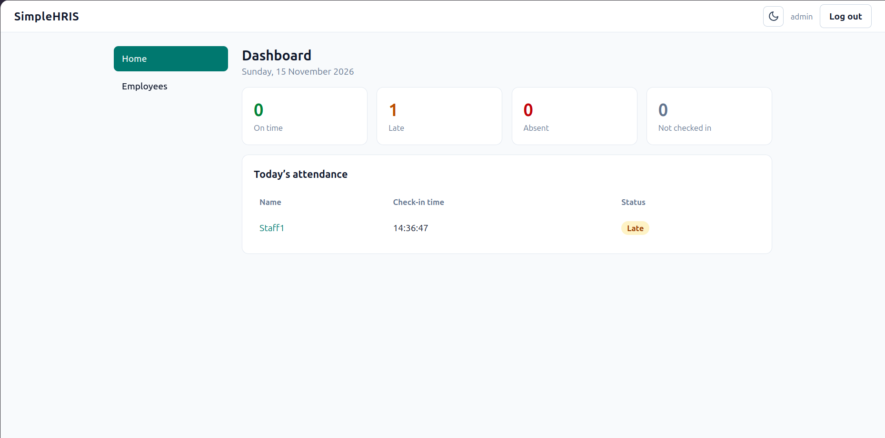
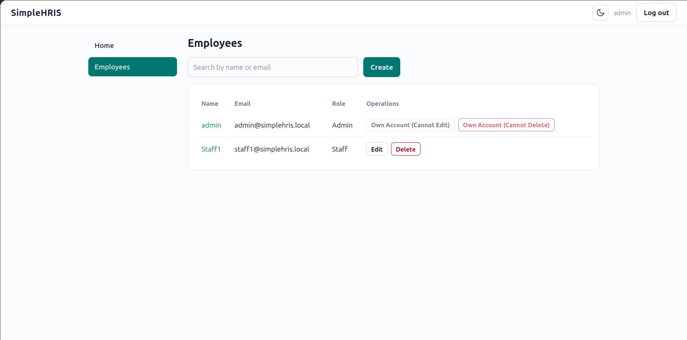
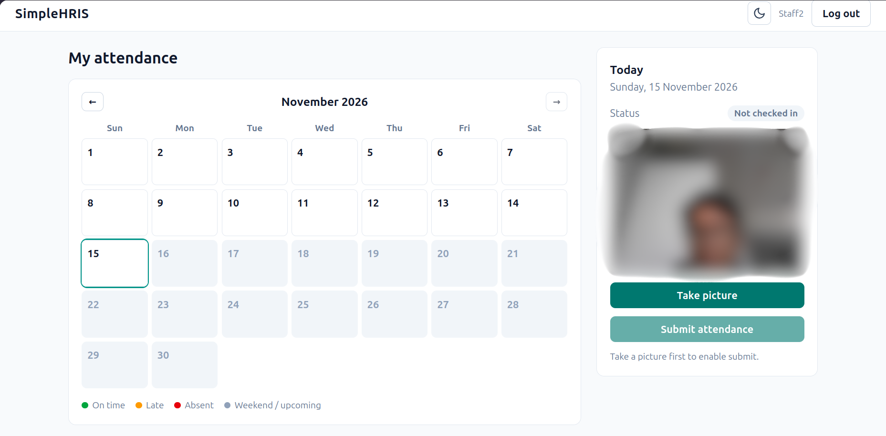
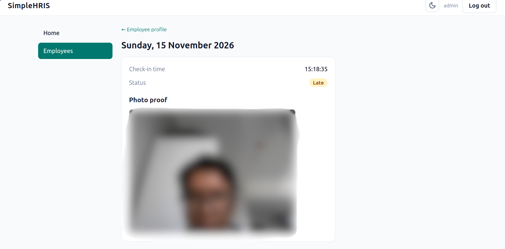
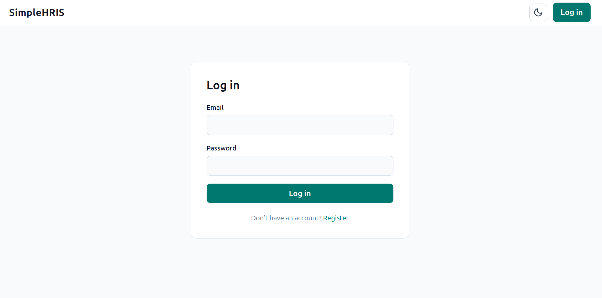

# SimpleHRIS

## Summary

SimpleHRIS is a web-based human resource information system for managing employee records and attendance. Administrators can maintain employee profiles and monitor daily attendance, while staff can check in with a photo and review their attendance history.

## Features

- Employee directory with search and tools to create, edit, and remove employee records
- Attendance dashboard with daily check-in totals, times, and statuses
- Staff check-in with a camera-captured photo for attendance proof
- Monthly attendance calendars, employee profiles, and per-day attendance details with photo proof
- Responsive interface with light and dark themes

## Technology Stack

### Frontend
- React
- TypeScript
- Tailwind CSS

### Backend
- Nest.js
- OracleDB
- TCP (Microservice)
- JWT for authentication

## Getting Started

### Environment Setup

1. Clone the repository:
```bash
git clone <repository-url>
cd SimpleHRIS
```

2. Create .env files (change .env.example to .env) for all services:
- backend
- frontend
- photos-service

3. Install dependencies:

```
npm i
```

### Running Locally 

1. Start the backend:
```bash
cd backend
npm run start:dev
```

2. Start the frontend:
```bash
cd frontend
npm run dev
```

3. Start the photos-service:
```bash
cd photos-service
npm run start:dev
```

4. Start the OracleDB Docker (or edit the env to use your own)
```
cd SimpleHRIS
docker compose up -d
```

5. Open the Frontend Website
```
http://localhost:5173
```

## Screenshots




